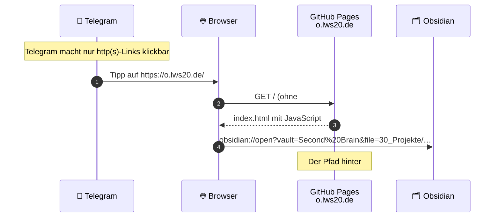

Weiterleitung von https://o.lws20.de/#<Pfad> auf obsidian://open für den Vault „Second Brain“. Der Pfad steht im Fragment und erreicht keinen Server.

Erzeugt werden die Links von `brain/links.py` im Repo [second-brain](https://github.com/adubdubdub/second-brain).
