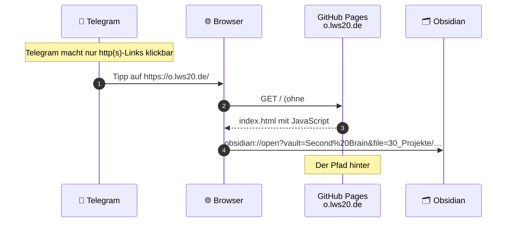

# obsidian-link

Weiterleitung von https://o.lws20.de/#<Pfad> auf obsidian://open für den Vault „Second Brain“. Der Pfad steht im Fragment und erreicht keinen Server.

## Auf einen Blick
| | |
|---|---|
| **Zweck** | Link aus Telegram/Digest öffnet eine Notiz in Obsidian |
| **Aufruf** | `https://o.lws20.de/#<Pfad>` oder `https://o.lws20.de/#f=<Pfad>&h=<Abschnitt>` |
| **Ziel** | `obsidian://adv-uri` (mit `filepath`, ggf. `heading`), Rückfall `obsidian://open` im Vault „Second Brain“ |

> [!NOTE]
> Abschnittslinks (`[[Notiz#Abschnitt]]`) tragen den Abschnitt als `h=`; er wird als `heading=` an Advanced URI bzw. als `#Abschnitt` an `open` weitergereicht (seit 19.11.2026).

> [!WARNING]
> Namen mit `&` (alle MOCs) öffnen auf Android nur per Fingertipp: Die Seite springt hier nicht automatisch, der Knopf nutzt `obsidian://open` (Test 19.11.2026: automatischer Sprung per `adv-uri`/`open`/`advanced-uri`, auch doppelt codiert, scheiterte; Tipp auf `open` klappt). Debug-Ansicht: `#<Pfad>~d` zeigt Fragment und Zieladresse.

> [!NOTE]
> Der Pfad steht im Fragment (`#…`) und erreicht nie einen Server.

Erzeugt werden die Links von `brain/links.py` im Repo [second-brain](https://github.com/adubdubdub/second-brain).
